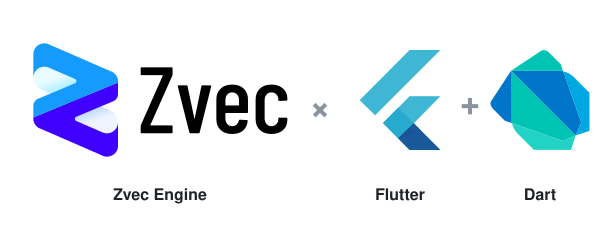

<p align="right">
  English | <a href="./README_zh.md">中文</a>
</p>

<p align="center">
  <picture>
    <source media="(prefers-color-scheme: dark)" srcset="https://raw.githubusercontent.com/zvec-ai/zvec-dart/main/assets/hero-dark.svg" />
    
  </picture>
</p>

<p align="center">
  <strong>Lightning-fast, in-process vector database for Dart &amp; Flutter — powered by <a href="https://github.com/alibaba/zvec">Zvec</a>.</strong>
</p>

<p align="center">
  <a href="https://pub.dev/packages/zvec"></a>
  <a href="https://github.com/zvec-ai/zvec-dart/blob/main/LICENSE"></a>
  <a href="#"></a>
  <a href="#"></a>
  <a href="#"></a>
  <a href="https://github.com/zvec-ai/zvec-dart/actions/workflows/2-test.yml"></a>
</p>

---

**Zvec Dart SDK** embeds the Zvec vector database in Flutter applications through `dart:ffi`. It supports vector search, filtered queries, full-text search and local persistent collections.

## Features

- Search HNSW, IVF and Flat indexes, filter on scalar fields, and combine vector and full-text results.
- Create typed schemas, insert documents and run synchronous queries through the C API.
- Persist collections across restarts with a write-ahead log and explicit flush.

## 📦 Installation

```bash
flutter pub add zvec
```

To pin the 0.8 series, use `zvec: ^0.8.0` in your `pubspec.yaml`.

The first Flutter build downloads the target's prebuilt C API library from the official Zvec release and verifies its SHA-256 checksum. Set Android `minSdk` to 28 or higher, the iOS deployment target to 14.0 or higher, and the macOS deployment target to 11.0 or higher. The macOS framework contains both Intel and Apple Silicon binaries. [Platform support](PLATFORM_SUPPORT.md) · [Upstream SDK archives](https://github.com/alibaba/zvec/releases/tag/v0.8.0)

## Upgrading from 0.5.x

- The engine now embeds its default Jieba dictionary and HMM model. Remove calls to `ConfigData.setJiebaDictDir` and `Zvec.setDefaultJiebaDictDir`, along with reads of `jiebaDictDir` and `defaultJiebaDictDir`. `FtsIndexParams(tokenizerName: 'jieba')` enables Chinese FTS with the embedded defaults.
- To supply a custom dictionary directory, pass `jieba_dict_dir` in the JSON string accepted by `FtsIndexParams.extraParams`. Use `user_dict_path` to add domain vocabulary. A process-level `ZVEC_JIEBA_DICT_DIR` also supplies a default directory for fields that have no override. [Upstream migration notes](https://zvec.org/en/blog/2026-10-20-zvec-release/#upgrade-notes)
- The `GroupByVectorQuery` constructor still accepts `groupTopk` for the maximum number of hits per group.

## ⚡ Quick Start

```dart
import 'dart:typed_data';
import 'package:zvec/zvec.dart';

void main() {
  // 1. Boot the engine
  Zvec.initialize();
  print('Zvec ${Zvec.version}');

  // 2. Define a schema: 4-dim FP32 vector + a string field
  final schema = CollectionSchema(name: 'demo', fields: [
    VectorSchema('embedding', 4, indexParams: HnswIndexParams()),
    FieldSchema(name: 'title', dataType: DataType.string),
  ]);

  // 3. Create & open the collection
  final collection = Collection.createAndOpen('/tmp/zvec_demo', schema);

  // 4. Insert documents
  final docs = [
    Doc(id: 'doc_1')
      ..setField('title', 'hello')
      ..setVector('embedding', Float32List.fromList([0.1, 0.2, 0.3, 0.4])),
    Doc(id: 'doc_2')
      ..setField('title', 'world')
      ..setVector('embedding', Float32List.fromList([0.2, 0.3, 0.4, 0.1])),
  ];
  collection.insert(docs);
  for (final d in docs) d.destroy();

  // 5. Build the index
  collection.optimize();

  // 6. Vector search — top-k by cosine similarity
  final query = VectorQuery(
    fieldName: 'embedding',
    vector: Float32List.fromList([0.4, 0.3, 0.3, 0.1]),
    topk: 5,
    outputFields: ['title'],
  );
  for (final r in collection.query(query)) {
    print('${r.pk}  score=${r.score}  title=${r.getString('title')}');
  }
  query.destroy();

  // 7. Clean up
  collection.close();
  Zvec.shutdown();
}
```

A full Flutter demo lives in [`example/lib/main.dart`](example/lib/main.dart).

## Contributing

To run the tests or regenerate bindings, see the [developer guide](BUILDING.md).

## 📄 License

Released under the [Apache License 2.0](LICENSE) — same as upstream Zvec.
