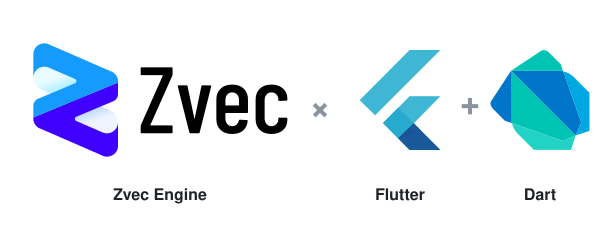

<p align="right">
  <a href="./README.md">English</a> | 中文
</p>

<p align="center">
  <picture>
    <source media="(prefers-color-scheme: dark)" srcset="https://raw.githubusercontent.com/zvec-ai/zvec-dart/main/assets/hero-dark.svg" />
    
  </picture>
</p>

<p align="center">
  <strong>面向 Dart &amp; Flutter 的高性能进程内向量数据库 — 由阿里巴巴开源的 <a href="https://github.com/alibaba/zvec">Zvec</a> 提供动力。</strong>
</p>

<p align="center">
  <a href="https://pub.dev/packages/zvec"></a>
  <a href="https://github.com/zvec-ai/zvec-dart/blob/main/LICENSE"></a>
  <a href="#"></a>
  <a href="#"></a>
  <a href="#"></a>
  <a href="https://github.com/zvec-ai/zvec-dart/actions/workflows/2-test.yml"></a>
</p>

---

**Zvec Dart SDK** 通过 `dart:ffi` 将 Zvec 向量数据库嵌入 Flutter 应用，支持向量查询、条件过滤、全文检索和本地持久化。

## 特性

- 使用 HNSW、IVF 或 Flat 索引检索向量，通过标量字段过滤，或合并向量和全文检索结果。
- 使用强类型 schema 定义集合，通过 C API 同步写入和查询文档。
- 使用预写日志和显式刷盘来持久化集合，应用重启后可重新打开。

## 📦 安装

```bash
flutter pub add zvec
```

如需使用 0.8 系列，在 `pubspec.yaml` 中指定 `zvec: ^0.8.0`。

首次构建会从 Zvec 官方 Release 下载目标平台的 C API 原生库，并验证压缩包的 SHA-256。Android 应用的 `minSdk` 至少为 28，iOS 部署目标至少为 14.0，macOS 至少为 11.0。macOS framework 同时包含 Intel 和 Apple Silicon 两种架构。[平台支持说明](PLATFORM_SUPPORT.md) · [上游 SDK 下载](https://github.com/alibaba/zvec/releases/tag/v0.8.0)

## 从 0.5.x 升级

- 引擎已内嵌默认 Jieba 词典和 HMM 模型。移除 `ConfigData.setJiebaDictDir`、`Zvec.setDefaultJiebaDictDir` 调用以及读取 `jiebaDictDir`、`defaultJiebaDictDir` 的代码。使用 `FtsIndexParams(tokenizerName: 'jieba')` 即可启用默认中文分词。
- 自定义词典目录通过 `FtsIndexParams.extraParams` 的 JSON 字符串传入 `jieba_dict_dir`，追加业务词汇使用 `user_dict_path`。进程级环境变量 `ZVEC_JIEBA_DICT_DIR` 可为未指定目录的字段提供默认值。[上游迁移说明](https://zvec.org/en/blog/2026-10-20-zvec-release/#upgrade-notes)
- `GroupByVectorQuery` 仍使用构造参数 `groupTopk` 指定每组最多返回的结果数。

## ⚡ 快速开始

```dart
import 'dart:typed_data';
import 'package:zvec/zvec.dart';

void main() {
  // 1. 初始化引擎
  Zvec.initialize();
  print('Zvec ${Zvec.version}');

  // 2. 定义 Schema：4 维 FP32 向量字段 + 一个字符串字段
  final schema = CollectionSchema(name: 'demo', fields: [
    VectorSchema('embedding', 4, indexParams: HnswIndexParams()),
    FieldSchema(name: 'title', dataType: DataType.string),
  ]);

  // 3. 创建并打开 Collection
  final collection = Collection.createAndOpen('/tmp/zvec_demo', schema);

  // 4. 写入文档
  final docs = [
    Doc(id: 'doc_1')
      ..setField('title', 'hello')
      ..setVector('embedding', Float32List.fromList([0.1, 0.2, 0.3, 0.4])),
    Doc(id: 'doc_2')
      ..setField('title', 'world')
      ..setVector('embedding', Float32List.fromList([0.2, 0.3, 0.4, 0.1])),
  ];
  collection.insert(docs);
  for (final d in docs) d.destroy();

  // 5. 构建索引
  collection.optimize();

  // 6. 向量检索 —— 按相似度返回 Top-K
  final query = VectorQuery(
    fieldName: 'embedding',
    vector: Float32List.fromList([0.4, 0.3, 0.3, 0.1]),
    topk: 5,
    outputFields: ['title'],
  );
  for (final r in collection.query(query)) {
    print('${r.pk}  score=${r.score}  title=${r.getString('title')}');
  }
  query.destroy();

  // 7. 收尾
  collection.close();
  Zvec.shutdown();
}
```

完整的 Flutter 示例见 [`example/lib/main.dart`](example/lib/main.dart)。

## 参与贡献

运行测试或重新生成绑定的步骤见[开发指南](BUILDING_zh.md)。

## 📄 许可证

基于 [Apache License 2.0](LICENSE) 开源 —— 与上游 Zvec 保持一致。
